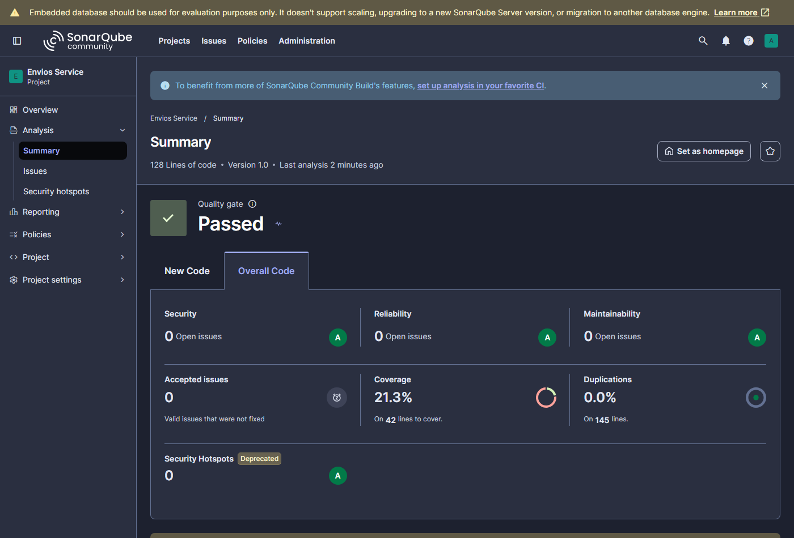
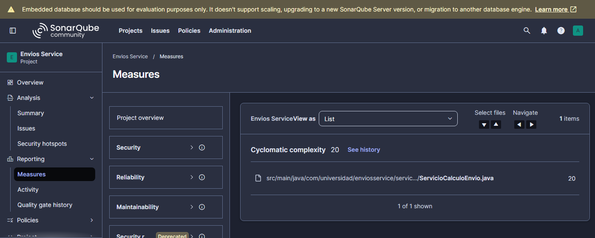
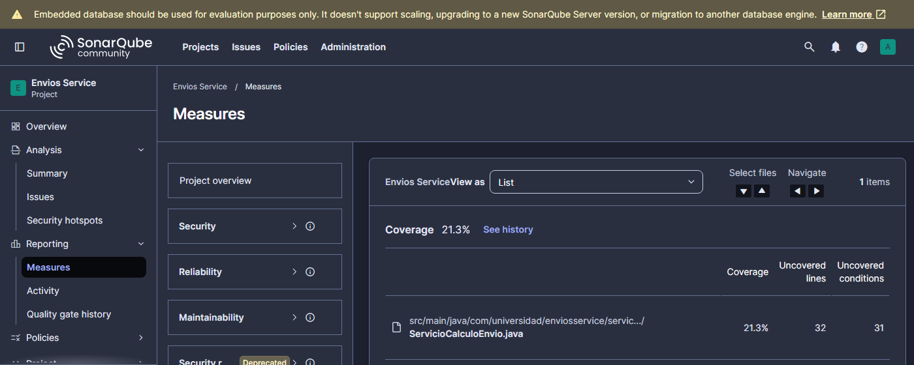
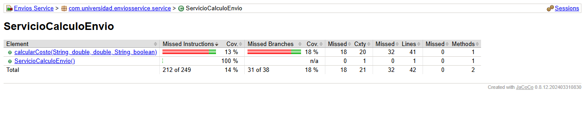
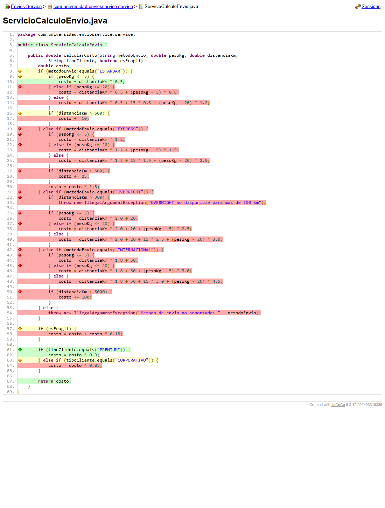

# Envios Service — Análisis de Métricas de Calidad

**Autor:** Juan Pablo Guerrero Hernández · Patrones de Diseño de Software · Unidad 10 · UDES

## Entorno de análisis

**Decisión de diseño 1: SonarQube Community Build 26.11 local**, instalado desde el ZIP oficial y
ejecutado con `StartSonar.bat` sobre Java 21, en `http://localhost:9000`.

- **Sin dependencia de conectividad ni de los límites del plan gratuito.** En SonarCloud, el plan
  gratuito no permite crear Quality Gates personalizados, y el Paso 9 exige el Quality Gate
  "Estándar Laboratorio". La instalación local da control total sobre los Quality Profiles y los
  Quality Gates.
- **Sin cuentas externas.** SonarCloud exige crear una cuenta, y con un repositorio público el
  dashboard quedaría visible para cualquiera. La instalación local solo necesita el usuario `admin`
  del propio servidor.
- **Costo asumido:** consume recursos de la máquina (unos 2 GB de RAM entre Elasticsearch, el web
  server y el compute engine) y debe estar corriendo durante todo el laboratorio.
- **Por qué sin Docker:** Docker Desktop no está instalado en el equipo. El ZIP oficial es
  exactamente el mismo servidor que la imagen `sonarqube:community` y corre con el JDK 21 ya
  instalado, sin WSL2 ni permisos de administrador.

El proyecto se registró con nombre **Envios Service** y key **`com.universidad:envios-service`**,
con un token de tipo *Project Analysis Token* que se pasa por línea de comandos y nunca se versiona.

## Estado inicial del análisis

Valores leídos del dashboard y de la API de SonarQube después de `mvn clean verify sonar:sonar`
(primer análisis), y del reporte HTML de JaCoCo:

| Métrica | Valor real observado |
|---------|----------------------|
| Complejidad ciclomática de `calcularCosto()` | **20** (SonarQube: 20 en el archivo, cuyo único método explícito es `calcularCosto`; JaCoCo: Cxty = 20 en el método) |
| Complejidad cognitiva de `ServicioCalculoEnvio` | **32** |
| Cobertura de líneas de `ServicioCalculoEnvio` | **23,8 %** (10 de 42 líneas) |
| Cobertura de ramas de `ServicioCalculoEnvio` | **18,4 %** (7 de 38 condiciones; 31 sin cubrir) |
| Cobertura global (SonarQube) | **21,3 %** |
| Code Smells reportados | **0** |
| Duplicación | 0,0 % |
| Quality Gate (Sonar way, por defecto) | Passed |

## Interpretación

**¿Qué método concentra el problema?** `ServicioCalculoEnvio.calcularCosto()`. En
*Measures → Complexity* SonarQube asigna 20 al archivo. La clase solo tiene ese método (más el
constructor implícito, que no suma), y el reporte de JaCoCo confirma Cxty = 20 en el método.
El valor coincide con el conteo manual: 1 (base) + 4 (cadena `if/else if` de `metodoEnvio`) + 12
(tramos de peso y recargos por distancia de las cuatro ramas) + 1 (`esFragil`) + 2 (`tipoCliente`).

**¿Qué ramas quedaron sin cubrir?** Las dos pruebas de partida solo recorren `ESTANDAR`, con 3 kg y
100 km, para un cliente REGULAR y otro PREMIUM. En el reporte de JaCoCo
([captura](docs/jacoco-ramas-inicial.png)) quedan en rojo o amarillo:

| # | Rama sin cubrir (línea del código original) | Estado en JaCoCo |
|---|---|---|
| R1 | `ESTANDAR`, tramo de 5 a 20 kg (l. 11-12) | rojo |
| R2 | `ESTANDAR`, tramo de más de 20 kg (l. 14) | rojo |
| R3 | `ESTANDAR`, recargo por más de 500 km (l. 16-17) | amarillo: solo se probó el caso falso |
| R4 | Toda la rama `EXPRESS`: 3 tramos, recargo por más de 500 km y factor 1,3 (l. 19-30) | rojo |
| R5 | Toda la rama `OVERNIGHT`: excepción por más de 300 km y 3 tramos (l. 31-40) | rojo |
| R6 | Toda la rama `INTERNACIONAL`: 3 tramos y recargo por más de 5000 km (l. 42-51) | rojo |
| R7 | Método no soportado, `IllegalArgumentException` (l. 54) | rojo |
| R8 | Recargo por fragilidad, `esFragil == true` (l. 57-58) | amarillo: solo se probó `false` |
| R9 | Descuento `CORPORATIVO` (l. 63-64) | amarillo: solo se probó el caso falso |

**¿Complejidad y cobertura apuntan al mismo método?** Sí, coinciden en `calcularCosto()`, y no es
casualidad. Una CC de 20 significa al menos 20 caminos independientes, y la suite solo ejercita 2,
así que la baja cobertura de ramas (18,4 %) es consecuencia directa de concentrar todas las
decisiones en un solo método. Además, cada prueba nueva tiene que llegar a la rama correcta de una
cadena de cinco `if/else if` antes de verificar algo, lo que hace que escribir pruebas sea costoso.

**Hallazgo sobre los Code Smells.** El análisis reporta **0 code smells** aunque el método tiene CC
20 y complejidad cognitiva 32. La causa es que SonarQube 26.11 asigna por defecto el perfil
**"Sonar way core"** (263 reglas), que no activa ni S1541 (complejidad ciclomática) ni S3776
(complejidad cognitiva). Un dashboard en verde con el Quality Gate en *Passed* no significa que el
código sea mantenible: solo significa que no se incumplió ninguna regla *activa*. Esto justifica
crear el Quality Profile "Estándar Laboratorio" en la Parte 2.

**Decisión de diseño 2: exclusiones del análisis.** **No se excluye ninguna clase**
(`sonar.exclusions` queda documentado y vacío en `sonar-project.properties`). El proyecto no tiene
clase `Main`, DTOs ni código generado. Todo lo que hay en `src/main/java` es lógica de negocio, y
excluir algo solo maquillaría el porcentaje de cobertura.

**Decisión de diseño 3: señal principal = complejidad ciclomática.**
- Fue la única de las tres señales que **identificó el método de forma inequívoca y explicó a las
  otras dos**. CC 20 indica cuántos caminos independientes hay, que es el número mínimo de pruebas
  para cubrirlos, y por eso explica la baja cobertura.
- La **cobertura** (18,4 % de ramas) indica *dónde* faltan pruebas, pero no *por qué* el método es
  difícil de probar. Subirla sin tocar el diseño exigiría unas 20 pruebas contra un método que
  seguiría siendo frágil ante cada nuevo método de envío.
- La **complejidad cognitiva** (32) confirma el diagnóstico, pero mide la dificultad de *lectura*,
  sobre todo por el anidamiento. El objetivo de la Parte 2 es reducir el número de caminos que
  concentra un solo método, y eso es exactamente lo que mide la CC.
- Los **Code Smells** quedaron descartados como señal: valen 0 por el perfil por defecto.

## Capturas del análisis inicial

**Dashboard de SonarQube (primer análisis):**



**Measures → Complexity (CC = 20) y Measures → Coverage (21,3 %, 31 condiciones sin cubrir):**




**Reporte JaCoCo:** el método tiene 18 % de ramas cubiertas y Cxty = 20. Las ramas sin ejercitar
aparecen en rojo o amarillo.




## Ejecutar el análisis

```bash
mvn clean verify                                   # pruebas + reporte JaCoCo (target/site/jacoco)
mvn clean verify sonar:sonar -Dsonar.token=TOKEN   # análisis en SonarQube local
```
