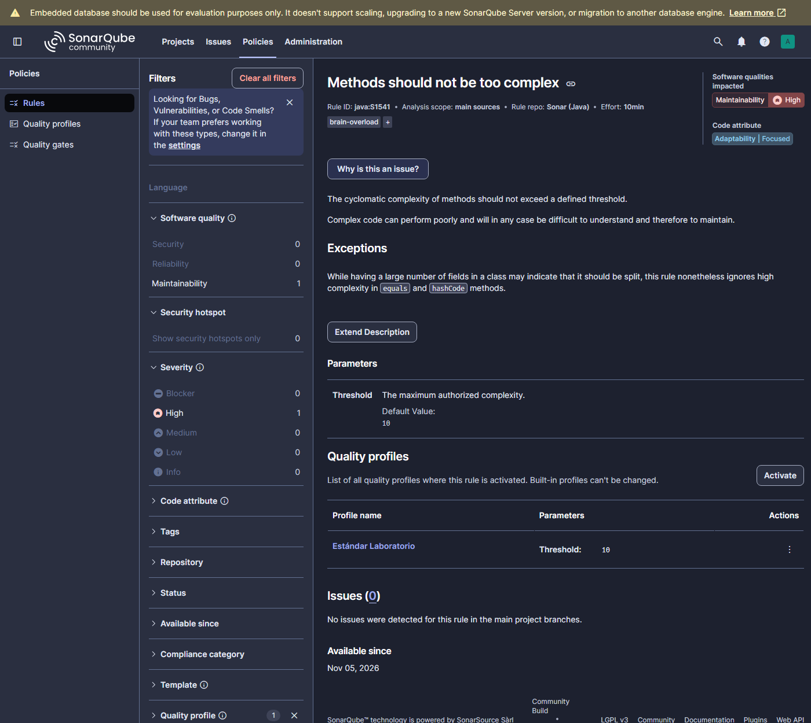
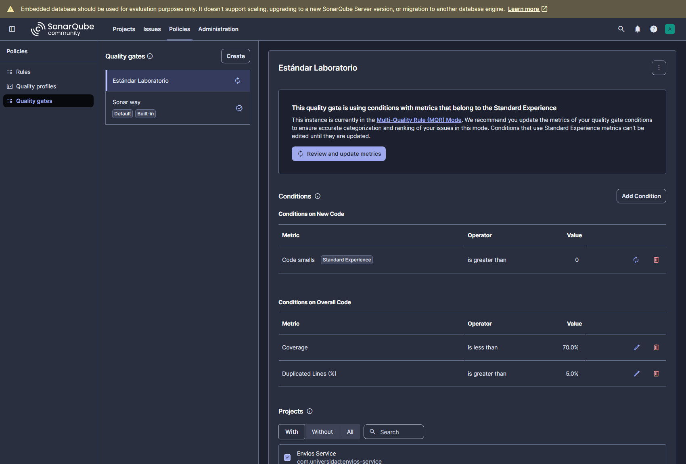
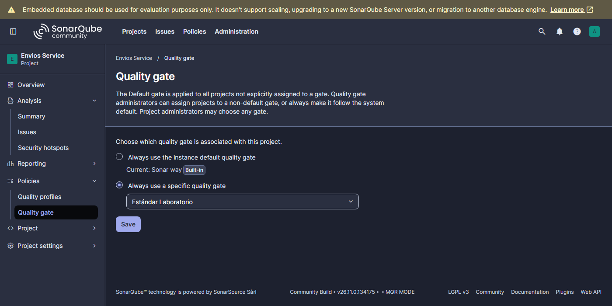
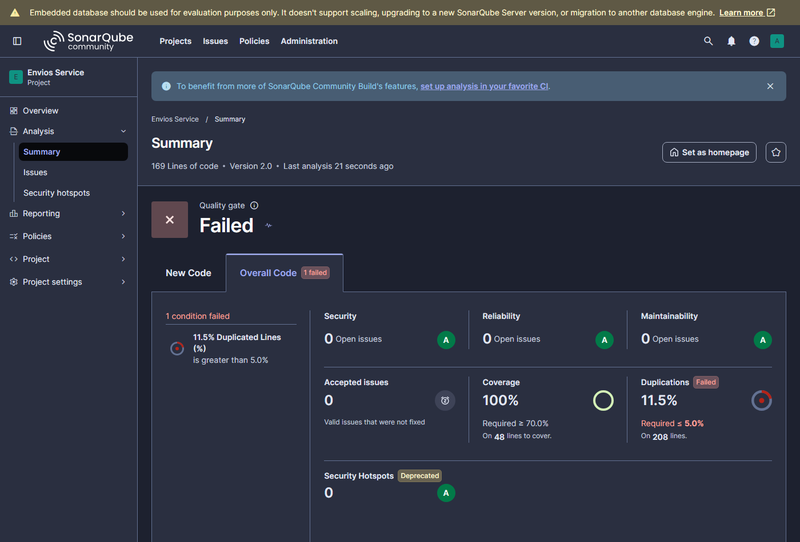
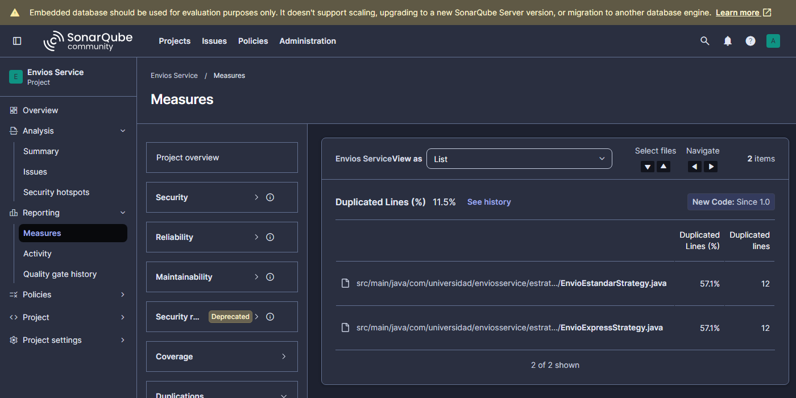
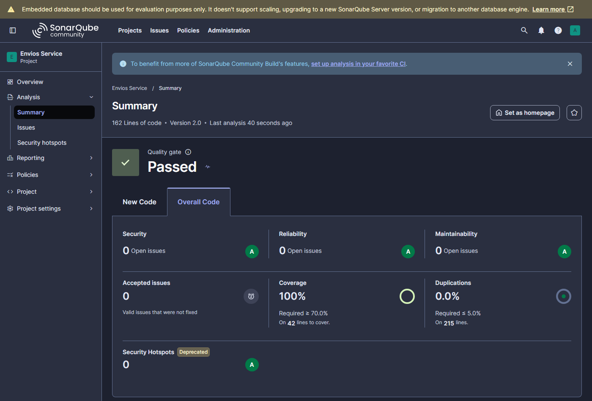
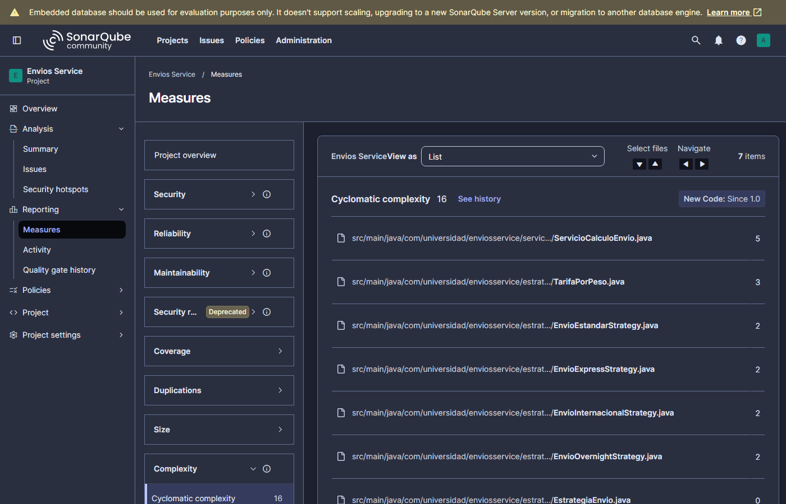
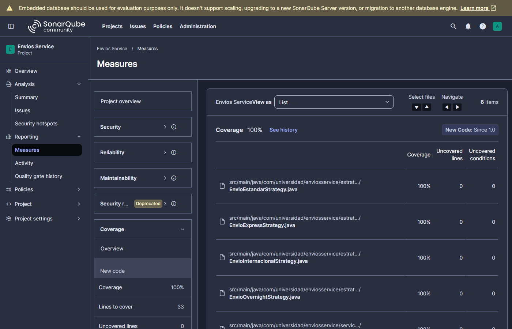
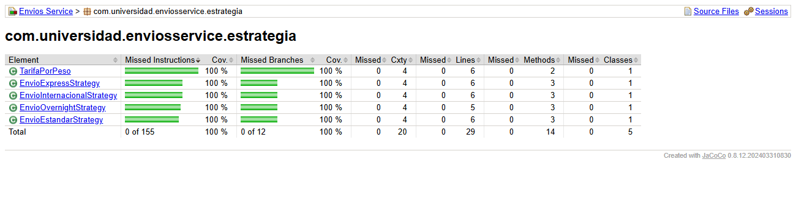
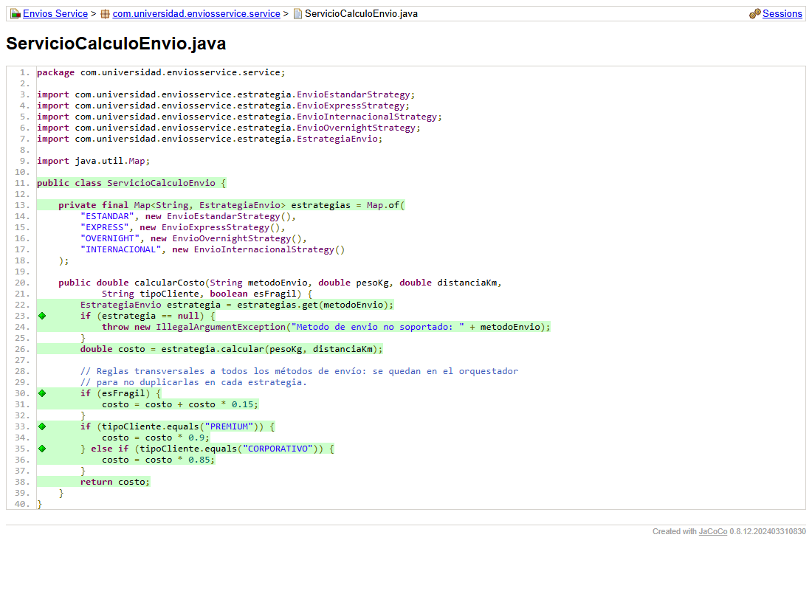

# Envios Service — Diagnóstico y Mejora Guiada por Métricas

**Autor:** Juan Pablo Guerrero Hernández · Patrones de Diseño de Software · Unidad 10 · UDES

Post-contenido de la Unidad 10, *Métricas de Calidad y SonarQube*. Con SonarQube y JaCoCo se
diagnosticó el método `ServicioCalculoEnvio.calcularCosto()`, se refactorizó con el patrón
**Strategy** y se volvió a medir para comparar con evidencia real.

```
src/main/java/com/universidad/enviosservice/
├── service/ServicioCalculoEnvio.java       ← orquestador (CC 20 → 5)
└── estrategia/
    ├── EstrategiaEnvio.java                ← interfaz Strategy
    ├── EnvioEstandarStrategy.java          ┐
    ├── EnvioExpressStrategy.java           │ una estrategia por método de envío (CC 2 c/u)
    ├── EnvioOvernightStrategy.java         │
    ├── EnvioInternacionalStrategy.java     ┘
    └── TarifaPorPeso.java                  ← tramos de peso compartidos (elimina la duplicación)
src/test/java/com/universidad/enviosservice/
├── service/ServicioCalculoEnvioTest.java   ← 2 pruebas de partida + 6 nuevas
└── estrategia/*Test.java                   ← una clase de prueba por estrategia + TarifaPorPesoTest
```

## Decisiones de diseño

### 1. Entorno de análisis: SonarQube Community Build 26.11 local (sin Docker)

Se instaló el ZIP oficial de SonarQube Community y se ejecuta con `StartSonar.bat` sobre Java 21,
en `http://localhost:9000`. Se eligió por dos criterios de la tabla del Paso 1:

- **No depende de conectividad ni de los límites de un plan gratuito.** En el plan gratuito de
  SonarCloud no se pueden crear Quality Gates personalizados, y el Paso 9 exige el gate
  "Estándar Laboratorio". En local hay control total de los Quality Profiles y de los Quality Gates.
- **No requiere cuentas externas ni expone el dashboard.** SonarCloud exige una cuenta, y los
  proyectos públicos son visibles para cualquiera. En local solo existe el usuario `admin` del
  propio servidor.
- **Costo asumido:** consume recursos de la máquina, alrededor de 2 GB de RAM entre Elasticsearch,
  el web server y el compute engine, y debe mantenerse corriendo durante todo el laboratorio.

**Por qué sin Docker:** Docker Desktop no está instalado en el equipo. El ZIP oficial es el mismo
servidor que la imagen `sonarqube:community` y funciona con el JDK 21 ya instalado, sin WSL2 ni
permisos de administrador. El proyecto se registró con key `com.universidad:envios-service` y un
*Project Analysis Token* que se pasa por línea de comandos y nunca se versiona.

### 2. Exclusiones del análisis: ninguna

`sonar.exclusions` queda documentado y vacío en `sonar-project.properties`. El proyecto no tiene
clase `Main`, DTOs ni código generado, y todo lo que hay en `src/main/java` es lógica de negocio que
debe medirse. Excluir algo solo maquillaría la cobertura. Por el mismo criterio, la interfaz
`EstrategiaEnvio` (sin líneas ejecutables) tampoco se excluyó, porque no afecta el porcentaje.

> **Nota técnica:** `mvn sonar:sonar` lee su configuración del `pom.xml` y no de
> `sonar-project.properties`. Por eso las propiedades clave están replicadas en el `<properties>`
> del pom. El archivo `.properties` queda como referencia comentada y es el que usaría el scanner
> CLI.

### 3. Métrica usada como señal principal: complejidad ciclomática

Fue la única señal que **identificó el método sin ambigüedad y explicó a las otras dos**:

- CC = 20 equivale a 20 caminos independientes, es decir, al menos 20 pruebas para cubrirlos. Con
  solo 2 pruebas, la baja cobertura de ramas (18,4 %) es una consecuencia directa de concentrar
  todas las decisiones en un solo método.
- La **cobertura** indica *dónde* faltan pruebas, pero no *por qué* el método es difícil de probar.
  Subirla sin cambiar el diseño exigiría muchas pruebas sobre un método que seguiría siendo frágil.
- La **complejidad cognitiva** (32) confirma el diagnóstico, pero mide la dificultad de lectura,
  sobre todo por el anidamiento. Lo que la Parte 2 debía reducir era el número de caminos que
  concentra un solo método, y eso es lo que mide la CC.
- Los **Code Smells** quedaron descartados como señal: el perfil por defecto reportó 0 (ver Parte 1).

### 4. Patrón elegido: Strategy

Se aplicó la tabla del Paso 7 a la naturaleza real de los condicionales de `calcularCosto()`:

| Pregunta | Respuesta para `calcularCosto()` | Consecuencia |
|---|---|---|
| ¿Guarda estado entre llamadas que condicione el comportamiento futuro? | **No.** `ServicioCalculoEnvio` no tiene campos mutables. Cada llamada depende solo de sus 5 parámetros, y calcular un envío EXPRESS no cambia lo que pasa en la siguiente llamada. No hay "estados" ni "transiciones válidas". | **Descarta State** |
| ¿Hay una secuencia de responsables donde importa el orden y varios podrían aplicar? | **No.** Los valores de `metodoEnvio` son **mutuamente excluyentes**: exactamente una rama aplica, y reordenar la cadena `if/else if` no cambia ningún resultado. Ninguna rama "pasa" la solicitud a la siguiente. | **Descarta Chain of Responsibility** |
| ¿Cada rama calcula el mismo tipo de resultado con una fórmula propia, elegida una vez por un valor discreto? | **Sí.** Las cuatro ramas devuelven un costo base `double` a partir de `(pesoKg, distanciaKm)`, cada una con su tarifa por km, cargo fijo, tramos de peso, recargo por distancia y restricción propios. | **Strategy** |

**Qué se movió a las estrategias y qué quedó en el orquestador:**

- **Estrategias:** solo lo que depende del método de envío, es decir, su fórmula, su recargo por
  distancia, el factor 1,3 de EXPRESS y la restricción de 300 km de OVERNIGHT (el `throw` se movió
  a `EnvioOvernightStrategy`).
- **Orquestador:** la búsqueda de la estrategia en un `Map`, el error por método no soportado y las
  **reglas transversales**: recargo por fragilidad y descuento por tipo de cliente. Esas reglas
  aplican igual a los cuatro métodos. Si se movieran a cada estrategia, la lógica quedaría escrita
  cuatro veces. Por eso el orquestador queda en CC 5 y no en 1.

**Iteración guiada por la métrica de duplicación.** La primera versión del refactor, igual a la de
la guía, repetía la cadena de tramos de peso dentro de cada estrategia. El análisis con el nuevo
Quality Gate **falló por 11,5 % de líneas duplicadas** (bloques de 12 líneas entre
`EnvioEstandarStrategy` y `EnvioExpressStrategy`), según las capturas
[dashboard](docs/sonar-dashboard-strategy-duplicacion.png) y
[duplicación](docs/sonar-duplicacion-strategy.png). Esa estructura de tramos (hasta 5 kg, de 5 a
20 kg y más de 20 kg) se extrajo al record `TarifaPorPeso`, que recibe solo las dos tarifas. Cada
estrategia conserva su propio algoritmo y delega únicamente el recargo por peso. Así la duplicación
bajó a **0,0 %** y cada estrategia bajó de CC 4 a CC 2.

**Equivalencia verificada.** Se compararon el método original (tomado del historial de git) y el
refactorizado en **2160 combinaciones**: 5 métodos, 3 tipos de cliente, 9 pesos y 8 distancias en
los límites de tramo, con y sin fragilidad. Hubo **0 diferencias**, incluidos los mensajes de las
excepciones.

### 5. Criterio de pruebas agregadas

Cada prueba nueva corresponde a una rama que el reporte JaCoCo de la Parte 1 marcó en rojo o
amarillo. Ninguna repite un caso ya cubierto sin verificar un valor distinto, y se incluyen los
**valores límite** de cada tramo (5 kg, 20 kg, 300 km, 500 km y 5000 km), que es donde suelen
aparecer los errores de tipo `<` frente a `<=`.

| Rama sin cubrir (Parte 1) | Prueba que la cubre |
|---|---|
| R1. ESTANDAR, tramo de 5 a 20 kg | `EnvioEstandarStrategyTest.calculaCostoPorTramoDePeso` (8 kg y 20 kg) |
| R2. ESTANDAR, más de 20 kg | `EnvioEstandarStrategyTest.calculaCostoPorTramoDePeso` (25 kg) |
| R3. ESTANDAR, recargo por más de 500 km | `EnvioEstandarStrategyTest.aplicaRecargoSoloPorEncimaDe500Km` (500 km sin recargo, 600 km con recargo) |
| R4. Rama EXPRESS completa | `EnvioExpressStrategyTest`: 3 tramos y el recargo **antes** del factor 1,3, que es (720 + 25) · 1,3 y no 720 · 1,3 + 25 |
| R5. Rama OVERNIGHT completa | `EnvioOvernightStrategyTest`: 3 tramos, 300 km permitidos y la excepción en 301 km con su mensaje |
| R6. Rama INTERNACIONAL completa | `EnvioInternacionalStrategyTest`: 3 tramos y recargo por más de 5000 km (límite incluido) |
| R7. Método no soportado | `ServicioCalculoEnvioTest.rechazaMetodoDeEnvioNoSoportado` (verifica el mensaje) |
| R8. `esFragil == true` | `aplicaRecargoDel15PorCientoAPaqueteFragil` y `aplicaRecargoPorFragilidadAntesDelDescuento` (orden de las reglas) |
| R9. Descuento CORPORATIVO | `aplicaDescuentoClienteCorporativo` y `delegaEnLaEstrategiaDelMetodoSolicitado` (EXPRESS + CORPORATIVO) |
| Nuevo: `TarifaPorPeso` | `TarifaPorPesoTest`: los dos lados de cada límite de tramo |

**Error de la guía detectado por las pruebas:** el ejemplo de `EnvioOvernightStrategyTest` esperaba
**250,0** para 25 kg y 100 km, pero la fórmula, idéntica en el código original, da
100 · 2 + 20 + 15 · 2,5 + 5 · 3 = **272,5**. La prueba usa el valor correcto. Si se hubiera
ajustado el código para que coincidiera con el ejemplo, el refactor habría cambiado el
comportamiento.

Resultado: **35 pruebas** (2 de partida y 33 nuevas), con **100 % de líneas y ramas**.

### 6. Realismo del Quality Gate

| Configuración | Valor | Por qué este umbral y no otro |
|---|---|---|
| Regla S1541 (*Methods should not be too complex*) en el perfil "Estándar Laboratorio" | **Threshold = 10** | Según la Tabla 3.2 de la guía, 10 es el **techo del rango "Moderada"** y el valor por defecto de la regla. Un umbral de **5** obligaría a fragmentar métodos que todavía se entienden bien, como el orquestador (CC 5), sin ganar mantenibilidad. Uno de **20** aceptaría exactamente el método original, que es el problema que se quería detectar. |
| Coverage < 70 % | **70 %** | Es el mismo umbral LINE de JaCoCo que usa la guía. Exigir **100 %** es poco realista y genera incentivos perversos (Sección 2.3): pruebas triviales que invocan código sin verificar nada solo para llenar el número. Con 70 % queda margen para código de infraestructura sin forzar pruebas vacías. Este proyecto llega a 100 % porque es pura lógica de negocio, no porque el gate lo exija. |
| New Code Smells > 0 | **0** | Con S1541 activa en el perfil, cualquier método nuevo o modificado con CC > 10 bloquea el gate. Es la forma de llevar al gate un límite por método, que el gate no admite de forma nativa porque solo trabaja con métricas agregadas. |
| Duplicated Lines (%) > 5 % | **5 %** | Tolera coincidencias pequeñas e inevitables. Aun así **detectó una duplicación real** que introdujo el propio refactor (11,5 %), lo que demuestra que el umbral es exigente sin ser arbitrario. |

**Hallazgos de SonarQube 26.11 documentados:**

- El perfil Java por defecto es **"Sonar way core"**, no "Sonar way", y **no activa** S1541 ni
  S3776. Por eso el método con CC 20 tuvo 0 code smells. El perfil "Estándar Laboratorio" se creó
  copiando "Sonar way core" y activando S1541 con Threshold = 10, y se asignó al proyecto.
- Al crear un gate, la versión 26 agrega automáticamente 4 condiciones "Clean as You Code". Se
  eliminaron para que el gate tenga **solo las 3 condiciones** del laboratorio.
- La instancia corre en modo *Multi-Quality Rule (MQR)*. La condición "Code smells" aparece con la
  etiqueta *Standard Experience*, pero se evalúa con normalidad: en el análisis final reportó 0.
- El proyecto se versionó como **2.0** en la Parte 2. Con New Code = *previous version*, todo el
  refactor cuenta como **código nuevo** frente a la versión 1.0, así que la condición
  *New Code Smells* evalúa justo el código modificado.

## Comparación antes / después

Valores reales de la API y del dashboard de SonarQube y del reporte de JaCoCo:

| Métrica | Antes (Parte 1, v1.0) | Strategy inicial (v2.0) | **Después (Parte 2, final)** | Variación |
|---|---|---|---|---|
| Complejidad ciclomática de `calcularCosto()` | 20 | 5 | **5** | **−75 %** |
| CC máxima de un método en el proyecto | 20 | 5 | **5** | −75 % |
| CC de cada estrategia (`calcular`) | — | 4 | **2** | — |
| Complejidad cognitiva total | 32 | 19 | **10** | −69 % |
| Cobertura de ramas de la lógica de envío | 18,4 % (7/38) | 100 % (32/32) | **100 % (20/20)** | **+81,6 pp** |
| Cobertura de líneas | 23,8 % (10/42) | 100 % | **100 % (42/42)** | +76,2 pp |
| Cobertura global (SonarQube) | 21,3 % | 100 % | **100 %** | +78,7 pp |
| Code Smells | 0 (perfil por defecto, sin reglas de complejidad) | 0 | **0** (perfil Estándar Laboratorio, S1541 = 10) | — |
| Duplicación | 0,0 % | 11,5 % | **0,0 %** | — |
| Pruebas | 2 | 30 | **35** | — |
| Quality Gate | Passed (*Sonar way* por defecto) | **Failed**: duplicación 11,5 % > 5 % | **Passed (Estándar Laboratorio)** | — |

**Interpretación:**

- La CC de `calcularCosto()` bajó 75 %, por encima del 50 % pedido, y ningún método del proyecto
  supera ahora CC 5, la mitad del umbral de S1541. La complejidad total del proyecto (16) es menor
  que la del método original solo (20), porque `TarifaPorPeso` escribe una sola vez la lógica de
  tramos que antes aparecía cuatro veces.
- La cobertura de ramas subió 81,6 puntos, por encima de los 15 pedidos, con pruebas que verifican
  valores concretos de cada rama.
- El denominador de condiciones bajó de 38 a 20: hay menos decisiones que probar para el mismo
  comportamiento, y esa es la mejora estructural de fondo.

## Capturas

### Parte 1: análisis inicial

**Dashboard (v1.0):**


**Measures → Complexity (20) y Coverage (21,3 %):**


**JaCoCo inicial:** 18 % de ramas, Cxty 20, y las ramas sin cubrir en rojo o amarillo.


### Parte 2: configuración del Quality Profile y del Quality Gate

**Regla S1541 activa en "Estándar Laboratorio" con Threshold 10:**



**Quality Gate "Estándar Laboratorio" con sus 3 condiciones, asignado a Envios Service:**




### Parte 2: Strategy inicial, gate fallido por duplicación




### Parte 2: análisis final

**Dashboard final:** Quality Gate en Passed, 100 % de cobertura y 0,0 % de duplicación.



**Measures → Complexity (orquestador 5, estrategias 2) y Coverage (100 %):**




**JaCoCo final:** paquete `estrategia` y orquestador con 100 % de ramas.




## Ejecutar el proyecto y el análisis

```bash
mvn clean verify                                   # 35 pruebas + reporte JaCoCo en target/site/jacoco/index.html
mvn clean verify sonar:sonar -Dsonar.token=TOKEN   # análisis en SonarQube local (http://localhost:9000)
```

Para levantar SonarQube local, ejecuta `bin\windows-x86-64\StartSonar.bat` de la distribución
Community. El servidor está listo cuando `http://localhost:9000/api/system/status` responde
`"status":"UP"`.

## Herramientas utilizadas

- Java 21, Apache Maven 3.9, JUnit 5 (pruebas parametrizadas)
- SonarQube Community Build 26.11 (local, sin Docker) y JaCoCo 0.8.12
- Git y GitHub

## Conclusiones

Una métrica sirve cuando se interpreta, no cuando solo se copia. El primer análisis mostró un
Quality Gate en *Passed* con 0 code smells para un método con CC 20, porque el perfil por defecto no
medía complejidad: un dashboard en verde solo dice que no se rompió ninguna regla *activa*. La
complejidad ciclomática resultó la mejor señal porque explicaba la baja cobertura: 20 caminos
contra 2 pruebas. Analizar la naturaleza de los condicionales llevó con argumentos a Strategy y no
a State ni a Chain of Responsibility, porque no había estado entre llamadas ni ramas que se pasaran
la solicitud. Por último, el Quality Gate demostró su valor al detectar una duplicación introducida
por el propio refactor. Corregirla redujo aún más la complejidad, lo que muestra que medir antes y
después también sirve para evitar mejoras que crean problemas nuevos.
